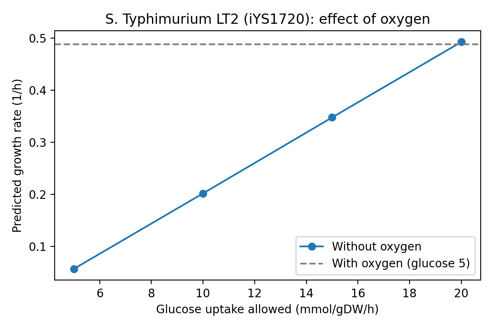

# Testing a Salmonella genome-scale metabolic model against lab knowledge

A first project in constraint-based metabolic modeling. I tested whether a published
genome-scale model of *Salmonella* Typhimurium LT2 reproduces behavior that is well known
from microbiology lab work.

**Model:** iYS1720, *S.* Typhimurium LT2 (Seif et al., 2018), downloaded from the
[BiGG Models database](http://bigg.ucsd.edu/models/iYS1720). 3,357 reactions, 1,707 genes.
**Tool:** [COBRApy](https://opencobra.github.io/cobrapy/), flux balance analysis (FBA).
**Default medium:** minimal glucose medium with salts (similar to M9), aerobic.

## Summary of results

| # | Question | Lab knowledge | Model result | Match? |
|---|---|---|---|---|
| 1 | Does growth slow without oxygen? | Yes, but growth continues | 0.488 → 0.057 /h with glucose capped at 5; 0.493 /h when glucose uptake is raised to 20 | Yes, once the glucose limit is adjusted |
| 2 | Which carbon sources support growth? | Glucose, citrate, glycerol, acetate, succinate: yes. Lactose: typically no | 5 of 6 matched. Lactose: 0.908 /h | **No for lactose** (see below) |
| 3 | Which genes are essential in minimal medium? | Biosynthesis genes for amino acids, nucleotides, vitamins, cell envelope | 157 essential genes, in exactly those pathways. *hisB* mutant rescued by histidine | Yes |
| 4 | Does tetrathionate support anaerobic growth? | Yes (basis of tetrathionate enrichment broth; advantage in the inflamed gut) | Glycerol, no O₂: 0 → 0.075 /h with tetrathionate. Uses *ttrABC*. Deleting *ttrA* removes growth | Yes |

## 1. Oxygen

With the default glucose limit (5 mmol/gDW/h), removing oxygen dropped growth from 0.488
to 0.057 /h, about 8.5 times slower. That is slower than expected from lab experience.

**Hypothesis:** the glucose limit is set for aerobic growth, but fermenting cells take up
glucose much faster to compensate for the low energy yield.

**Test:** raising the anaerobic glucose limit to 10, 15 and 20 increased growth steadily,
reaching 0.493 /h at 20, similar to aerobic growth.

**Lesson:** predictions depend strongly on the uptake limits. The realistic anaerobic
glucose uptake rate has to come from lab measurements.

## 2. Carbon sources and a lactose mismatch

Each carbon source was tested alone at 5 mmol/gDW/h under aerobic conditions.

| Carbon source | Growth (/h) | Lab knowledge |
|---|---|---|
| Glucose | 0.488 | grows |
| Lactose | 0.908 | **typically does not grow** (lactose-negative on MacConkey) |
| Citrate | 0.351 | grows (Simmons citrate positive) |
| Glycerol | 0.265 | grows |
| Acetate | 0.099 | grows |
| Succinate | 0.234 | grows |

**Investigation:** lactose use depended on reaction `LACZpp` (lactose + H₂O → glucose +
galactose), linked to gene `G2583_2669`. This is not an LT2 (STM) locus tag; it appears
to come from an *E. coli* strain. *S.* Typhimurium lacks *lacZ*.

**Test:** knocking out `G2583_2669` gave no growth on lactose (0), matching lab knowledge,
while growth on glucose was unchanged (0.488).

**Note:** about 25% of gene IDs in this model file (429 of 1,707) do not use STM locus
tags. Many appear to be *E. coli*, UniProt or other-strain identifiers, and many probably
correspond to genes Salmonella does have. I did not check them all. The lactose case shows
that at least some can lead to wrong predictions.

## 3. Essential genes

Each of the 1,707 genes was deleted one at a time (`single_gene_deletion`). A gene was
called essential if growth fell below 1% of wild type.

- **157 essential genes** (plus `s0001`, a placeholder for spontaneous reactions).
- They fall in pathways for amino acids (*his, ilv, phe, tyr, arg*), nucleotides
  (*pur, pyr*), vitamins (riboflavin, folate, NAD), peptidoglycan (*murA, murC, murD,
  murF*), lipopolysaccharide (*lpx, rfa*) and fatty acids (*accA*). This is expected in
  minimal medium, where the cell must synthesize everything.
- Some are known drug targets, e.g. *murA* (target of fosfomycin).
- **Auxotroph check:** deleting *hisB* stopped growth (0); adding histidine to the medium
  restored it (0.492).

Full list: `sim3_essential_genes.csv`

## 4. Tetrathionate respiration

On glycerol without oxygen, the model could not grow (0). Adding tetrathionate allowed
growth (0.075 /h). The reaction (tetrathionate → 2 thiosulfate) uses the real Salmonella
genes *ttrA*, *ttrB*, *ttrC* (STM1383–STM1385). Deleting *ttrA* removed the benefit
(growth back to 0).

This matches the basis of tetrathionate enrichment broth, and the known advantage
tetrathionate respiration gives Salmonella in the inflamed gut (Winter et al., *Nature*,
2010).

## Limitations

- FBA predicts the **maximum possible** growth given the reactions and limits. It does not
  model gene regulation, stress, temperature or competition with other microbes.
- Growth rates depend on uptake limits I chose (e.g. 5 mmol/gDW/h for each carbon
  source), not on measured values.
- Lab comparisons are qualitative (grows / does not grow), based on standard
  microbiology knowledge rather than my own experiments.

## What I learned

The model reproduced most known Salmonella behavior, but lab knowledge caught one clear
error (lactose) and showed how strongly predictions depend on assumed limits (oxygen).
Connecting model predictions with experimental data is the part of this field I most want
to learn.

## Files

| File | Contents |
|---|---|
| `explore_salmonella.ipynb` | All code, results and notes |
| `toy_model.py` | A 5-reaction toy model I used to learn how FBA works |
| `sim1_oxygen_results.csv` | Simulation 1 data |
| `fig_sim1_oxygen.png` | Simulation 1 figure |
| `sim2_carbon_results.csv` | Simulation 2 data |
| `sim3_essential_genes.csv` | Simulation 3 essential gene list |

**To run:** `pip install cobra pandas matplotlib`, then open the notebook. The first cell
downloads the model from BiGG.

## References

- Seif Y, et al. Genome-scale metabolic reconstructions of multiple *Salmonella* strains
  reveal serovar-specific metabolic traits. *Nature Communications* 9:3771 (2018).
- Orth JD, Thiele I, Palsson BØ. What is flux balance analysis? *Nature Biotechnology*
  28:245–248 (2010).
- Winter SE, et al. Gut inflammation provides a respiratory electron acceptor for
  *Salmonella*. *Nature* 467:426–429 (2010).
- Ebrahim A, et al. COBRApy: COnstraints-Based Reconstruction and Analysis for Python.
  *BMC Systems Biology* 7:74 (2013).

*Lekhraj Dhakal, November 2026*
